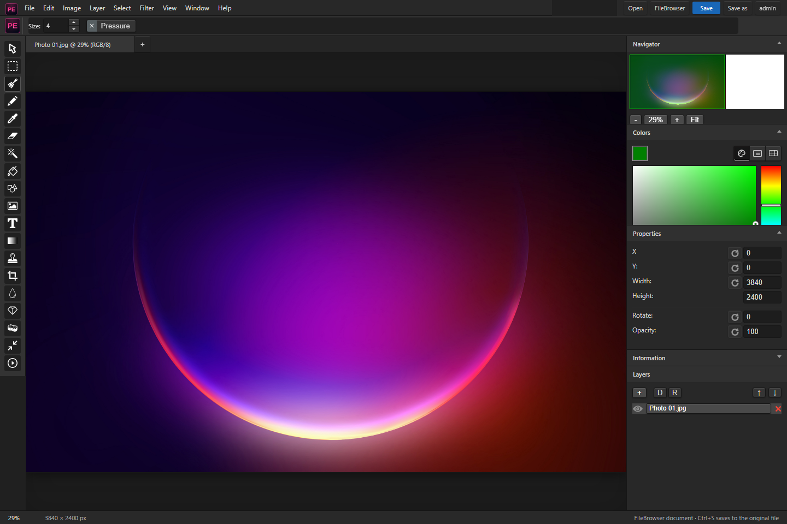

#  Photo Editor · Studio

A portable image editor with a dark desktop workspace, real drawing tools, layers and filters. Edit device files on their own, or connect to My Drive to open and save images through FileBrowser.

[Download Studio for Windows](https://github.com/oneworkspacestudio/Photo-Editor/releases) · [Usage and configuration](STUDIO.md) · [FileBrowser adapter](integrations/filebrowser/install.ps1) · [One Workspace](https://github.com/oneworkspacestudio/one-workspace)



*Actual desktop interface opening a sample image through an isolated Drive connection. Local editing is also available without an account.*

## Create and edit

- Draw, select, crop, resize, add text and apply filters with miniPaint's existing image engine.
- Work with layers, undo/redo, colours and a canvas preview in one compact workspace.
- Open device images and layered miniPaint JSON projects. Save a layered project or export a flattened PNG, JPEG or WebP.
- Use **Open**, **Save** and **Save as**, with familiar `Ctrl+O`, `Ctrl+S` and `Ctrl+Shift+S` shortcuts.
- Connect FileBrowser for authenticated file access, revision checks and overwrite-conflict feedback.

## Start the Windows app

1. Download the [Studio preview](https://github.com/oneworkspacestudio/Photo-Editor/releases).
2. Run `Studio.exe`. It opens the editor at `http://localhost:8870`.
3. Choose **Open** for a device image, or start with a new canvas.
4. Use **Save** or **Save as**. Browsers with File System Access support can write directly after permission; others download a copy.

Local editing does not require FileBrowser, Docker, Node.js or MyAccounts. Images are sent to FileBrowser only when using the connected server workflow.

## Connect to My Drive

Configure `Studio.json` beside the executable:

```json
{
  "listen": "localhost:8870",
  "filebrowser": "http://localhost:8810"
}
```

Install the [FileBrowser adapter](integrations/filebrowser/install.ps1) into an updated Drive build to provide the Studio file endpoints. In Drive, open **Image Studio** or use **Edit in Studio** from a supported image's menu.

Integrated Studio inherits Drive's account and file permissions. For a standalone companion sharing Drive's browser session, keep both on the same hostname; `localhost` and `127.0.0.1` are different cookie hosts. A separate MyAccounts client is optional for the independent app; it does not grant Drive file access by itself.

[Full setup, authentication and save behaviour](STUDIO.md)

## Build locally

Use the Windows build script with a writable staging folder:

```powershell
./scripts/build-windows.ps1 -BuildRoot 'I:/Build/Studio' `
  -OutputDirectory 'I:/Build/Studio-Portable' -GoExecutable 'go'
```

Building requires Node/npm and Go; running the packaged EXE does not. The script builds the web assets and embeds them in the portable executable. Builds run locally without GitHub Actions.

## Preview status

Studio is an unsigned evaluation build. It uses Photoshop-style layout conventions and miniPaint's engine; it is not Adobe software and does not provide full Photoshop/PSD parity. The built-in file save and login paths have documented limits; see [STUDIO.md](STUDIO.md). Current source artwork may be newer than an already published EXE.

## Credits and license

Built on [viliusle/miniPaint](https://github.com/viliusle/miniPaint), under the [MIT license](MIT-LICENSE.txt). Upstream tools, translations and contributors remain credited in the [archived upstream README](docs/README-archive.md). For upstream browser embedding and engine documentation, see the [miniPaint wiki](https://github.com/viliusle/miniPaint/wiki).
